  
  
  
  
  

##  About me

I'm **Deneth**, a full-stack developer from Sri Lanka. I design and build complete web products: the interface people use, the APIs and databases behind it, and the servers it runs on.

Most of what I build runs real businesses: multi-tenant SaaS, booking and POS systems, HR and hiring portals, online stores, payment flows, and the automation that ties them together.

 **Live in production:** [remnexus.lk](https://remnexus.lk) · [bizupward.com](https://bizupward.com) · [wingztopup.com](https://wingztopup.com) 
 **Right now:** REM Nexus (live, next phases), two new client systems, and planning BizUpward v2 
 **Frontend:** responsive interfaces, design systems and themes, accessible contrast, motion that respects the user 
 **Open source:** [Zipizy](https://github.com/denethraveesha-spec/Zipizy), local-first PDF, QR and developer tools 
 **Ask me about:** Next.js, NestJS, Prisma + PostgreSQL, multi-tenant SaaS, WhatsApp & Telegram automation, self-hosting

> [!NOTE]
> **Why are most of my repositories private?** They're commercial: my own products, and systems that run client businesses. The code stays private, but every project below is real, and I'm happy to give a live walkthrough or share code samples on request.

##  Featured work

###  REM Nexus · HR services & sports arena platform

&nbsp;`Client project` · `Private repo`

The group system for **Rem Nexus (Pvt) Ltd** and its two businesses, HR Axis Consultation and REM Sports Arena. Live today: the group website, a jobs site with a hiring portal, and a sportswear catalogue with team orders. Also built: the sports-arena module.

- **Monorepo:** Next.js web app and NestJS API sharing Zod schemas and permission keys; Prisma on PostgreSQL 17
- **Safe uploads:** every CV and image passes a ClamAV virus scan before it reaches S3-compatible storage
- **Least privilege:** role-based permissions in the app, and separate database roles for migrations, the API and backups
- **Tested:** dependency audit, typecheck, lint, unit tests, an API smoke test and Playwright end-to-end tests in CI (GitHub Actions)
- **Operated:** Docker in production with a staging server, twice-daily backups and tested restores
- **Built step by step:** 360+ commits, with every decision recorded alongside its reason

**Stack:** Next.js · NestJS · TypeScript · PostgreSQL · Prisma · Docker · Playwright · Cloudflare

###  BizUpward · Business platform for Sri Lankan SMEs

&nbsp;`My product` · `Private repo`

A multi-tenant SaaS where every business gets its own website and the tools to run it: online bookings, POS, stock, staff and payroll, customers and web orders, with WhatsApp and email notifications built in.

- **Multi-tenant, multi-branch:** tenant-scoped data access on every request; roles from super admin to owner, branch manager and staff
- **Many business types, one codebase:** a vertical registry adapts modules, wording and storefront per business (salon & beauty, retail & online store)
- **Website builder:** storefront themes, a visual editor and a subdomain for every business, with schema.org SEO
- **Commerce:** barcode POS with printed bills, cart and checkout with server-side price checks, stock that can't be deducted twice
- **Automation:** WhatsApp notifications, email OTP sign-up, a three-stage free-trial lifecycle, PDF payslips
- **Hardened:** short-lived access tokens with refresh and revocation, rate limiting, Zod validation, repeated security audits

**Stack:** Next.js · TypeScript · PostgreSQL · Prisma · Tailwind CSS · WhatsApp (Baileys) · Docker

> **Next:** BizUpward v2, re-planned from zero with business research, module plans and recorded decisions before any code is written.

###  WingZ Topup · Game top-up platform, built end to end

&nbsp;`Client project` · `Private repos`

An online store where players buy game top-ups and pay from a wallet. I designed and built every part of it: the storefront customers use, the engine that fulfils orders, and the bots and tools that run it day to day.

| Part | What it does | Built with |
| --- | --- | --- |
| **Storefront** | Accounts, wallet top-ups, rewards wheel, leaderboard, vouchers, reviews and a full admin panel | Next.js · NextAuth · Prisma · PostgreSQL |
| **Fulfilment engine** | Order queue, API-key REST gateway for partner sites, Telegram admin and reseller bots, WhatsApp and email alerts, live dashboard | Node.js · Express · Socket.IO · SQLite |
| **AI assistant** | WhatsApp chatbot that answers from each reseller group's own data and hands confirmed orders to the validated order path | Gemini API · Baileys |
| **Payment matching** | Android app that forwards eZ Cash payment SMS to a protected webhook, so wallet deposits confirm automatically | Kotlin · WorkManager |
| **Redeem center** | Multi-user platform for bulk code redemption with wallets, JWT auth, rate limiting and live progress | Express · React · SQLite · WebSockets |

###  VPS Manager · Control panel for self-hosted servers

`My tool` · `Private repo`

A single-server dashboard for VPSs that run projects under PM2 or Docker, designed to be fully usable from a phone.

- **Live health:** CPU, memory, disk and network pushed over WebSockets every two seconds, with sparklines
- **Every process and container:** PM2 processes and Docker containers, with their git branch, tag and "behind origin" status
- **One-tap deploys:** fetch → checkout → install → build → restart, streamed live, stopping at the first failure
- **Terminals in the browser:** a persistent shell for every project (node-pty + xterm.js)
- **Watchdog:** background checks for memory-leak signals, restart loops, OOM exits and full disks, with Telegram alerts

**Stack:** React · Node.js · Express · WebSockets · xterm.js · PM2 · Docker

###  Zipizy · Everyday tools that never upload your files

&nbsp;`Open source` · `Browser + Windows desktop`

PDF, image, text, QR and developer tools that run in the browser or as a Windows desktop app. Your files are processed on your own device.

- **Documents:** merge, split, extract and password-protect PDFs; turn JPG, PNG and HEIC images into PDFs
- **QR codes:** links, Wi-Fi, contact cards and WhatsApp
- **Developer tools:** JSON format and compare, regex tester, UUIDs, hashes, Base64
- **Built carefully:** heavy work runs in Web Workers, and the Electron shell keeps Node.js out of the pages

**Stack:** Astro · JavaScript · Web Workers · Electron

##  More work

| Project | Type | What I built | Stack |
| --- | --- | --- | --- |
| **Payments workspace** | Freelance client | One dashboard for clients, suppliers, transactions, bank transfers, rates and reports, with audit logs, Google Drive backups and Docker deploys | Next.js · SQLite · Docker |
| **Spa POS admin** | Freelance client | Invoice and revenue management for a spa: revenue dashboard, search, date filters, safe edits and admin accounts | PHP · MySQL |
| **Salon website & booking** | Client · in progress | Premium website demo with an end-to-end online booking flow, ahead of the full booking system | HTML · CSS · JavaScript |
| **Gift & chocolate store** | Client · in progress | Demo store with build-a-box, surprise bookings, checkout and order tracking, ahead of the production shop | HTML · CSS · JavaScript |
| **Super-app scoping** | Team · planning | Requirements summary and cost breakdown for a multi-service super app covering rides, delivery and commerce | Product planning |

##  How I work

1. **Demo first.** Clients click through a working demo before the real build starts, so we agree on what's being built.
2. **Plan, decide, then build.** Each project has a roadmap with acceptance checks, and every structural decision is written down with its reason.
3. **Small, verified steps.** Each step is built, tested on desktop and phone, and documented before the next one starts.
4. **Secure by default.** Role-based access, tenant isolation, input validation and rate limiting from day one, with audits before launch.
5. **I run what I ship.** Docker and PM2 deploys, staging servers, monitoring, and backups that are restore-tested.
6. **Modern tools, same discipline.** I use AI coding tools like Claude Code to move faster, inside the same plan → build → test → review process. The architecture and the decisions stay mine.

##  Tech stack

<table>
  <tr>
    <td><b>Languages</b></td>
    <td>
      
      
      
      
      
      
    </td>
  </tr>
  <tr>
    <td><b>Frontend</b></td>
    <td>
      
      
      
      
      
      
      
      
    </td>
  </tr>
  <tr>
    <td><b>Backend</b></td>
    <td>
      
      
      
      
      
      
      
    </td>
  </tr>
  <tr>
    <td><b>Data</b></td>
    <td>
      
      
      
      
    </td>
  </tr>
  <tr>
    <td><b>DevOps</b></td>
    <td>
      
      
      
      
      
    </td>
  </tr>
  <tr>
    <td><b>Integrations</b></td>
    <td>
      
      
      
      
      
      
      
    </td>
  </tr>
</table>

##  Have a project? Let's build it.

  <b>Hiring, or have a project in mind? Let's talk.</b> 
  Code samples and live walkthroughs of private projects are available on request.  
  
  
  

